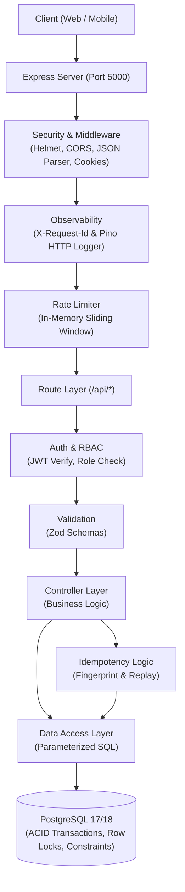
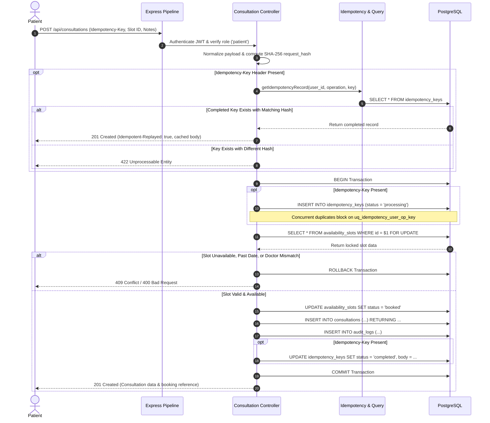
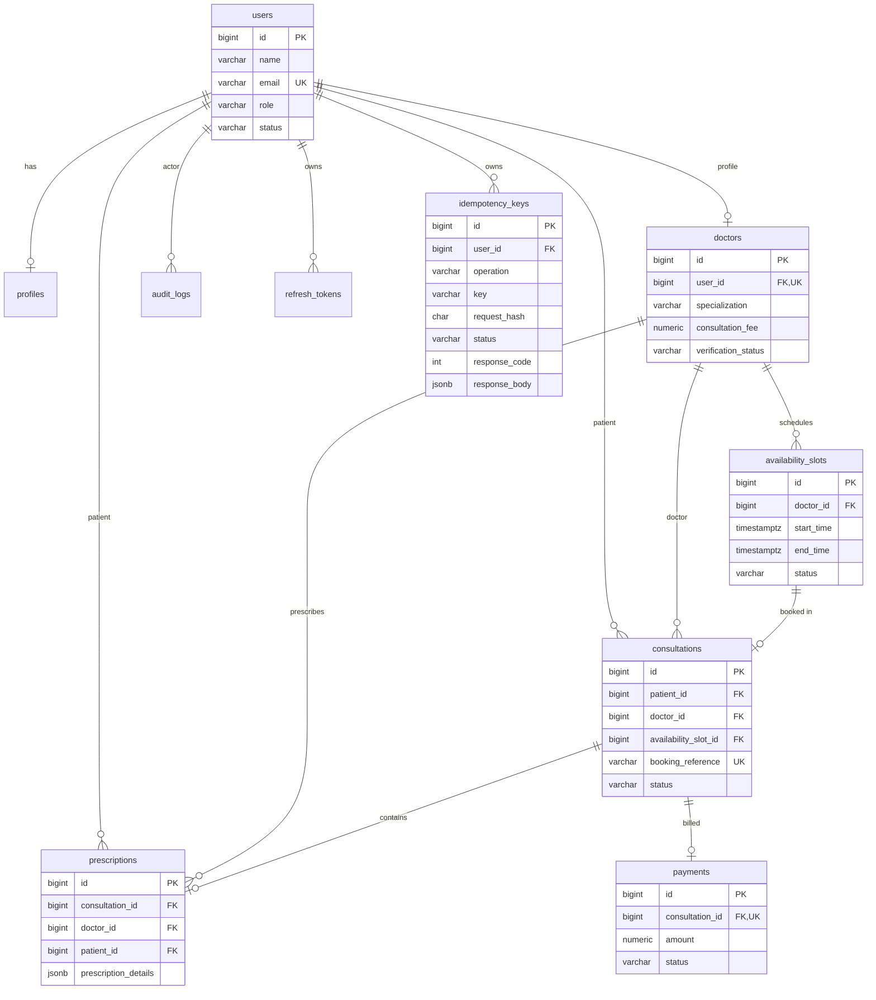

# System Architecture Document: Amrutam Telemedicine Backend

---

## 1. System Overview and Design Goals

The **Amrutam Telemedicine Backend** is a monolithic RESTful service supporting an Ayurvedic telemedicine platform. It connects registered patients with certified Ayurvedic doctors for appointment scheduling, consultation lifecycle management, structured digital prescriptions, payment tracking, and administrative oversight.

### Tech Stack & Architectural Style
- **Runtime & Web**: Node.js (v20+ LTS) with Express.js (v5) using CommonJS modules.
- **Database**: PostgreSQL (v17/v18) via native connection pooling (`pg.Pool`) using raw parameterized SQL without an ORM.
- **Security & Validation**: JWT (`jsonwebtoken`) access tokens, `bcryptjs` password hashing, Zod schema validation, `express-rate-limit`, and `helmet`.
- **Observability**: Structured JSON logging via `pino` and `pino-http` with `X-Request-Id` correlation.

The codebase implements a decoupled, layered Model-View-Controller (MVC) pattern (`routes` → `middleware` → `validators` → `controllers` → `query` → `PostgreSQL`). Direct SQL ensures predictable execution plans, zero ORM overhead, and absolute transaction control.

### Design Priorities
- **Security**: Defense-in-depth with rate limiting, RBAC, cryptographic token rotation, and SQL injection immunization.
- **Concurrency Safety**: Row locks (`SELECT ... FOR UPDATE`), GiST exclusion constraints, and partial unique indexes prevent double-booking at the database engine level.
- **Request Idempotency**: Safe write retries for booking backed by PostgreSQL transactions and SHA-256 payload hashing.
- **Maintainability**: Minimal dependencies, explicit layered boundaries, and comprehensive integration test coverage.

---

## 2. High-Level Architecture and Data Flow

Incoming HTTP requests pass through security and observability pipelines before dispatching to controllers and parameterized queries.

### Component Responsibilities
- **HTTP Routing & Middleware**: Dispatches requests, injects `X-Request-Id` (UUIDv4), applies CORS and Helmet headers, and enforces endpoint-level rate limits.
- **Authentication & RBAC**: Decodes JWT access tokens (`req.user = { id, role }`) and enforces role permissions (`patient`, `doctor`, `admin`).
- **Controllers**: Orchestrate business logic, transaction lifecycles, audit logging, and response serialization.
- **Query Layer**: Encapsulates parameterized SQL queries (`$1, $2, ...`), isolating database interactions from transport logic.
- **PostgreSQL Persistence**: Enforces ACID transactions, row-level locks, foreign keys, and relational constraints.

---

## 3. Core Workflows and Booking Sequence Diagram

### Principal Workflows
1. **Authentication & Token Rotation**: Users register and log in via `/api/auth`. The server issues short-lived access tokens (15m) and persistent refresh tokens (7d) stored in `refresh_tokens`. Reusing an invalidated refresh token triggers family-wide revocation.
2. **Doctor Availability**: Doctors manage calendar slots via `/api/availability`. A GiST exclusion constraint (`uq_doctor_slot_no_overlap`) rejects overlapping slots for the same doctor at the database level.
3. **Consultation Booking**: Patients reserve available slots via `POST /api/consultations`. Row locks (`FOR UPDATE`) serialize concurrent requests, while idempotency keys guarantee safe retries.
4. **Lifecycle & Prescriptions**: Assigned doctors advance consultations (`booked` → `in_progress` → `completed`). Doctors attach structured JSONB prescriptions via `/api/prescriptions`. Patient cancellations release slots back to `available`.
5. **Payment Tracking**: Patients log consultation payments via `/api/payments`. Duplicate payments on settled consultations return `409 Conflict`.
6. **Administration**: Admins review pending doctor profiles via `/api/admin/doctors/pending` and verify credentials via `PATCH /api/admin/doctors/:id/verify`.

### Consultation Booking Sequence Diagram

---

## 4. Data Model and ER Diagram

The database schema is managed via 7 sequential migrations tracked in `schema_migrations`.

### Relational Integrity and Constraints
- **Referential Integrity**: Clinical records (`consultations`, `prescriptions`, `payments`) use `ON DELETE RESTRICT` to protect medical history. Auxiliary records (`profiles`, `refresh_tokens`, `idempotency_keys`) use `ON DELETE CASCADE`.
- **Double-Booking Prevention**: Partial unique index `ON consultations(availability_slot_id) WHERE status != 'cancelled'` (`uq_consultations_active_slot`) prevents duplicate active bookings.
- **Overlap Prevention**: Exclusion constraint `uq_doctor_slot_no_overlap` using `btree_gist` prevents doctors from scheduling overlapping active slots.
- **Idempotency Scope**: Compound unique constraint `(user_id, operation, key)` enforces strict per-user and per-operation key scoping.

---

## 5. API Design and Security

### Endpoint Architecture
| Resource Group | Endpoints | Method | Access Control |
|---|---|---|---|
| **Auth** | `/api/auth/signup`, `/login`, `/refresh`, `/logout`, `/me` | POST, GET | Public (Rate-limited) / Authenticated |
| **Users** | `/api/users/profile` | GET, PUT | Authenticated (Self) |
| **Doctors** | `/api/doctors`, `/api/doctors/:id`, `/api/doctors/profile` | GET, PUT | Public / Doctor |
| **Availability** | `/api/availability`, `/api/availability/doctor/:id`, `/:id` | GET, POST, PATCH, DELETE | Public / Doctor |
| **Consultations**| `/api/consultations`, `/api/consultations/my`, `/:id`, `/:id/cancel` | POST, GET, PATCH | Patient / Authenticated / Doctor |
| **Prescriptions**| `/api/prescriptions`, `/api/prescriptions/my`, `/:id` | POST, GET | Doctor / Authenticated |
| **Payments** | `/api/payments`, `/api/payments/consultation/:id` | POST, GET | Patient / Authenticated |
| **Admin** | `/api/admin/metrics`, `/doctors/pending`, `/doctors/:id/verify` | GET, PATCH | Admin |
| **Health** | `/health/live`, `/health/ready` | GET | Public |

### Security Controls & Limitations
- **Authentication & RBAC**: Stateless JWT access tokens (15m) and persistent refresh tokens with family-level revocation upon reuse. Role middleware guards endpoints (`patient`, `doctor`, `admin`), while controllers enforce resource ownership.
- **Rate Limiting**: In-memory sliding window limiter via `express-rate-limit` (200 reqs/15m globally, 10 reqs/15m on auth endpoints).
- **Injection Protection & Sanitization**: 100% parameterized SQL queries. Pino loggers and audit log modules automatically scrub sensitive keys (`password`, `token`, `secret`, `cookie`).
- **Security Gaps**: Multi-Factor Authentication (MFA) is **not implemented**. Payment gateway integration is **internally simulated** without external webhook signatures. Field-level data encryption at rest in PostgreSQL is **not implemented**.

---

## 6. Reliability, Transactions, and Scalability

### Implemented Controls
1. **Row-Level Slot Locking**: `SELECT ... FOR UPDATE` acquires an exclusive lock on the requested slot, ensuring only one transaction books it.
2. **Atomic Commits**: Booking, slot status update, audit logging, and idempotency persistence occur inside a single transaction. Failures trigger an immediate `ROLLBACK`.
3. **Request-Level Idempotency**:
   - Evaluates `Idempotency-Key` header with SHA-256 payload hashing.
   - Matching retries receive stored response with `Idempotent-Replayed: true`.
   - Reused keys with modified payloads return `422 Unprocessable Entity`.
   - Omitting header preserves backward compatibility.
   - Concurrent duplicates block on `uq_idempotency_user_op_key` and safely replay once the winner commits.

### Scalability Roadmap (Target: 100,000 Daily Consultations)
An operational target of 100,000 daily consultations represents an average write rate of ~1.2 bookings/sec, with peak loads of 15–25 writes/sec and 150–250 reads/sec. Scaling reliably to this target requires:
1. **Connection Pooling**: Deploy PgBouncer to manage high client connection counts without exhausting PostgreSQL backends.
2. **Distributed Cache (Redis)**: Cache doctor profiles and availability queries with short TTLs and cache invalidation on slot mutation.
3. **Distributed Rate Limiting**: Move `express-rate-limit` to a shared Redis store for multi-instance deployments.
4. **Asynchronous Task Queues**: Offload audit logging, email/SMS notifications, and analytics to BullMQ or RabbitMQ workers.
5. **Table Partitioning**: Range-partition `consultations`, `audit_logs`, and `idempotency_keys` by date range to maintain bounded B-tree index sizes.

---

## 7. Observability, Deployment, and Disaster Recovery

### Observability
- **Structured JSON Logging**: Pino output captures timestamps, log levels, request IDs, HTTP verbs, paths, status codes, and latency.
- **Request Correlation**: The `requestId.middleware` extracts or generates an `X-Request-Id`, propagating it through logs, error payloads, and response headers.
- **Health Probes**: `GET /health/live` returns process uptime; `GET /health/ready` executes a database `SELECT 1` ping (returns `503` if disconnected).
- **Audit Trails**: Business events write structured audit records to `audit_logs` with sanitized JSONB metadata.

### Deployment & CI
- **Local Runtime**: Native Node.js (v20+ / v22+) connecting directly to a locally installed PostgreSQL (v17 or v18) instance without requiring Docker.
- **CI Pipeline**: GitHub Actions (`.github/workflows/ci.yml`) runs on pushes/PRs to `main`, `master`, and `develop`. It spins up an automated PostgreSQL 17 test service, executes migrations, and validates the test suite across Node.js 20.x and 22.x.

### Disaster Recovery
- **Backup Procedures**: Documented in `docs/backup-and-recovery.md` using native logical dumps (`pg_dump -F c`) and restore commands (`pg_restore`).
- **Recovery Gaps**: Continuous WAL archiving for Point-In-Time Recovery (PITR), automated backup schedules, and cloud object replication (e.g. AWS S3) are **not currently automated in code**.
- **Recommended Targets**: RPO < 15 minutes (via automated WAL archiving) and RTO < 30 minutes (via native PostgreSQL restore procedures).

---

## 8. Assignment Requirements Traceability

| Requirement Area | Current Repository Implementation | Status |
|---|---|---|
| **Core Telemedicine Workflows** | Complete CRUD for auth, doctor directory, availability, booking, prescriptions, payments, and admin verification. | **Implemented** |
| **Booking Concurrency Protection** | `SELECT ... FOR UPDATE` row locks, partial unique index `uq_consultations_active_slot`, and GiST exclusion constraint. | **Implemented** |
| **Request-Level Idempotency** | PostgreSQL table `idempotency_keys`, SHA-256 payload hashing, atomic transaction commit, 422 mismatch rejection, and safe replay. | **Implemented** |
| **Authentication & RBAC** | JWT access tokens, persistent refresh token rotation with family revocation, `bcryptjs` hashing, and role middleware. | **Implemented** |
| **Input Validation & Sanitization** | Strict Zod contracts on auth, user, doctor, and prescription payloads. Parameterized SQL queries on all database operations. | **Implemented** |
| **Audit Trails** | Database-persisted regulatory audit logs (`audit_logs`) capturing actor ID, action, entity, request ID, and sanitized JSONB metadata. | **Implemented** |
| **Structured Logging & Probes** | Pino JSON logging, `X-Request-Id` correlation, `/health/live` and `/health/ready` probe endpoints. | **Implemented** |
| **Rate Limiting** | In-memory sliding window limiter protecting global API and sensitive authentication endpoints. | **Implemented** |
| **Automated Testing & CI** | 167 automated unit and integration tests passing with Jest and Supertest; automated GitHub Actions CI pipeline on Node 20 and 22. | **Implemented** |
| **Local Runtime & PostgreSQL** | Pure Node.js, npm, and native PostgreSQL setup with zero Docker dependency for local execution. | **Implemented** |
| **Payment Gateway Integration** | Internal database record tracking only (`/api/payments`); external webhooks/gateway SDKs are not integrated. | **Partially Implemented** |
