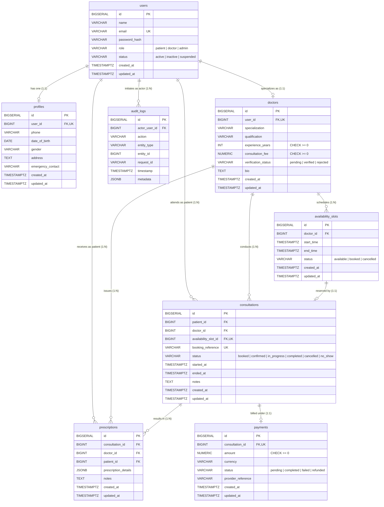

# Entity-Relationship (ER) Schema Diagram - 8 Core Tables

The database schema uses PostgreSQL 18 with 64-bit auto-incrementing numeric IDs (`BIGSERIAL`), `TIMESTAMPTZ` timestamps, and explicit foreign key cascades or restrictions.

